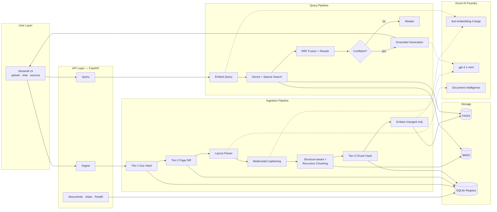
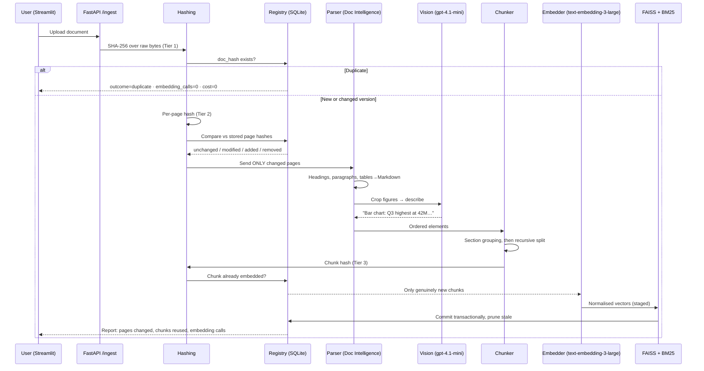
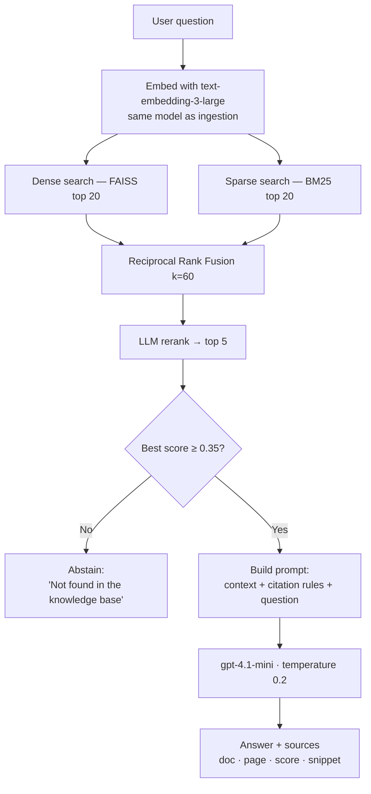

# Enterprise Knowledge Assistant — Production-Grade RAG

An internal question-answering system that lets any employee ask a plain-English
question and get a **cited, verifiable answer** drawn only from the company's own
documents — including the content locked inside **tables, images and charts**.

Built using **Spec-Driven Development (SDD)** with GitHub Spec Kit artifacts, so
every line of code traces back to a written, reviewable requirement.

---

## Table of Contents

1. [The Problem](#1-the-problem)
2. [What This Application Does](#2-what-this-application-does)
3. [Architecture at a Glance](#3-architecture-at-a-glance)
4. [Technology Stack — What and Why](#4-technology-stack--what-and-why)
5. [The Ingestion Workflow](#5-the-ingestion-workflow)
6. [The Two-Tier Hashing Technique](#6-the-two-tier-hashing-technique-the-core-idea)
7. [Parsing: Layout-Aware + Multimodal](#7-parsing-layout-aware--multimodal)
8. [Chunking: Structure-Aware + Recursive](#8-chunking-structure-aware--recursive)
9. [The Query Workflow](#9-the-query-workflow)
10. [Spec-Driven Development — Repository Map](#10-spec-driven-development--repository-map)
11. [Getting Started](#11-getting-started)
12. [Project Structure](#12-project-structure)
13. [Design Decisions and Trade-offs](#13-design-decisions-and-trade-offs)
14. [Known Limitations](#14-known-limitations-v1)

---

## 1. The Problem

Employees waste hours searching for information buried across PDFs, policy
manuals, Word documents and slide decks. Three things break conventional search:

1. **Vocabulary mismatch.** People ask *"how many leaves can I carry forward?"*
   The document says *"Accrual and Encashment of Earned Leave"*. Keyword search
   returns nothing.
2. **Invisible content.** Critical numbers live in tables and charts. Normal text
   extraction flattens a table into unreadable run-on text and ignores charts
   entirely.
3. **Hallucination.** A general-purpose chatbot has never seen our documents, and
   when it doesn't know, it invents an answer — which in a policy or compliance
   context is worse than no answer at all.

## 2. What This Application Does

| Capability | How it shows up for the user |
|---|---|
| **Grounded answers** | Answers come only from indexed documents, never from model memory |
| **Mandatory citations** | Every answer shows `document name — page number` and the exact source snippet |
| **Honest abstention** | If the answer isn't in the corpus, it says so rather than guessing |
| **Table intelligence** | Tables are preserved as structured Markdown, so "What is the Sev-2 SLA?" works |
| **Chart & image intelligence** | Figures are described by a vision model, so "Which quarter had the highest revenue?" works |
| **Zero-waste re-uploads** | Re-uploading an unchanged file costs nothing; editing one page reprocesses only that page |

---

## 3. Architecture at a Glance



---

## 4. Technology Stack — What and Why

| Layer | Technology | Why this choice |
|---|---|---|
| **Frontend** | Streamlit | Delivers a usable internal tool in a fraction of the effort of React. Chat, file upload and expandable panels are built in. |
| **Backend** | FastAPI | Async I/O for parallel Azure calls, Pydantic validation at the boundary, and auto-generated OpenAPI docs that satisfy our contract-first rule. |
| **LLM** | **gpt-4.1-mini** (Azure AI Foundry) | In a good RAG system the retriever does the hard work; the LLM only summarises supplied context. Mini gives that quality at a fraction of full-model cost — and its **native vision** covers chart captioning with one deployment. |
| **Embeddings** | **text-embedding-3-large** (Azure AI Foundry) | Retrieval quality sets the ceiling for the whole system. 3072 dimensions handle long technical passages and table text noticeably better than the small variant. |
| **Parsing** | Azure AI Document Intelligence (`prebuilt-layout`) | Returns headings, reading order, table **cell structure** and figure bounding boxes in one call — and stays inside our Azure tenant. Local `unstructured` + `pdfplumber` + Tesseract fallback for restricted networks. |
| **Vector store** | FAISS (`IndexFlatIP`) | Fast, free, in-process, exact search. No external service, no data egress. Sits behind an interface so swapping to Azure AI Search in v2 touches one file. |
| **Keyword search** | BM25 | Dense search fails on exact identifiers (ticket IDs, policy codes). BM25 catches them. |
| **Fusion** | Reciprocal Rank Fusion | Combines two rankings whose scores are on incomparable scales, without needing normalisation. |
| **Registry** | SQLite + SQLAlchemy | Hash bookkeeping needs real ACID transactions so a failed run can't corrupt the index. Zero infrastructure; connection-string swap to Azure SQL later. |
| **Hashing** | SHA-256 (stdlib) | Collision-resistant. MD5 is unacceptable for an integrity-critical identity key. |
| **Deployment** | Python venv — **no Docker** | Deliberate product decision driven by corporate virtualisation restrictions. Reproducibility comes from pinned `requirements.txt` + documented setup. |

---

## 5. The Ingestion Workflow



## 6. The Two-Tier Hashing Technique (the core idea)

This is the piece that makes the system economical at enterprise scale.

**The problem it solves:** a 400-page policy manual is re-uploaded because
someone corrected a typo on page 7. A naive system re-parses all 400 pages and
re-embeds every chunk — paying full cost for a one-word change.

**Three tiers of change detection:**

| Tier | Hash over | Question answered | Saving |
|---|---|---|---|
| **1 — Document** | Raw file bytes | *Is this the exact same file?* | Duplicate rejected in milliseconds; **100%** of cost avoided |
| **2 — Page** | Normalised page text **+** structural signature | *Which pages actually changed?* | Only changed pages are re-parsed; typically **95%+** avoided |
| **3 — Chunk** | Normalised chunk text | *Which chunks on a changed page actually changed?* | Sibling chunks on the edited page are reused |

**Two details that make it actually work in production:**

- **Normalisation before hashing.** PDF exports carry generation timestamps in
  the footer. Without stripping repeating headers/footers, collapsing whitespace
  and lowercasing, *every* page would hash as modified on *every* re-export —
  destroying the entire saving.
- **Structural signature inside the page hash.** Two pages can have identical
  text but different layout (a paragraph restructured into a table). Text-only
  hashing would call that "unchanged" and keep the wrong chunks. The signature
  `h:2|p:7|t:1|i:1|order:h,p,p,t,p,i` catches it.

**Worked example — 40-page document, one line edited on page 7:**

| Metric | Without hashing | With three-tier hashing |
|---|---|---|
| Pages parsed | 40 | **1** |
| Chunks embedded | ~160 | **~2** |
| Embedding calls | ~160 | **~2** |
| Time | minutes | seconds |

## 7. Parsing: Layout-Aware + Multimodal

**Layout-aware** means we never do `text = pdf.extract_text()`. The parser
returns *structure*: which text is a heading, what the reading order is, where
each table's cells sit, and where each figure is.

- **Tables** → serialised to GitHub-flavoured Markdown with the header row kept.
  A table stays a single atomic chunk unless it exceeds the token budget, in
  which case it splits by rows with the header repeated in each part.
- **Images and charts** → the figure region is cropped from its bounding box and
  sent to **gpt-4.1-mini vision**, which returns a factual description. That
  description is embedded like any other text, so a chart becomes searchable
  with exactly the same machinery. Captions are cached by image hash, so re-runs
  cost nothing.
- **Scanned pages** → OCR path engages automatically.

*Why this matters:* "Which quarter had the highest revenue?" is unanswerable from
OCR of a bar chart. It is trivially answerable from a one-sentence description.

## 8. Chunking: Structure-Aware + Recursive

Two passes, in this order:

1. **Structure-aware pass.** Group elements into sections using the heading
   hierarchy the parser already gave us. A chunk never spans two top-level
   sections.
2. **Recursive pass.** *Only* for sections over the token budget, split down a
   separator ladder: `## heading → ### heading → paragraph → line → sentence →
   word`, with 120-token overlap.

Every chunk is prefixed with its **breadcrumb**. A chunk reading
*"…must be approved within 48 hours"* is meaningless on its own. Prefixed with
`HR Policy > Leave > Emergency Leave`, it is both retrievable and interpretable.

| Setting | Value |
|---|---|
| Target chunk | 800 tokens |
| Max chunk | 1,000 tokens |
| Overlap | 120 tokens |

*Why not fixed-size?* It cuts tables and sentences in half — the classic cause of
nonsense retrieval. *Why not semantic chunking?* It costs an embedding pass just
to decide boundaries and is non-deterministic across runs, which would make
chunk hashes unstable and break Tier-3 reuse.

## 9. The Query Workflow



Two guarantees are enforced here:

- **Hybrid retrieval** — dense search handles paraphrase, sparse search handles
  exact identifiers. They fail on different inputs, so we run both.
- **Deterministic abstention** — a numeric confidence gate, not a polite
  instruction in the prompt. Prompt instructions are probabilistic; a threshold
  is not. It also saves the generation cost on hopeless queries.

---

## 10. Spec-Driven Development — Repository Map

Instead of jumping straight to code, we wrote the specification first. Each
artifact answers one question:

| Artifact | Answers | Read it if you are… |
|---|---|---|
| `.specify/memory/constitution.md` | *What rules can never be broken?* | Reviewing a pull request |
| `specs/001-enterprise-rag/spec.md` | *What are we building, and why?* | A manager or business reviewer |
| `specs/001-enterprise-rag/plan.md` | *How will we build it?* | An architect or tech lead |
| `specs/001-enterprise-rag/research.md` | *Why this technology and not that one?* | Anyone asking "why did we do it this way?" |
| `specs/001-enterprise-rag/data-model.md` | *What are the entities, fields and states?* | A developer touching the database |
| `specs/001-enterprise-rag/contracts/openapi.yaml` | *What is the exact API?* | A frontend or integration developer |
| `specs/001-enterprise-rag/tasks.md` | *Who does what, in what order?* | A developer picking up work |
| `specs/001-enterprise-rag/quickstart.md` | *How do I run it?* | Anyone, on day one |

**Why this pays off:** scope is settled on day one instead of sprint three;
decisions are written down instead of living in one person's head; tasks carry
exact file paths so developers work in parallel without merge conflicts; and
acceptance criteria written as Given/When/Then convert directly into test cases.

**Traceability chain:** `Constitution → spec.md (FR-xxx) → plan.md → tasks.md
(T0xx) → code → tests`. Any code with no requirement behind it is scope creep.

---

## 11. Getting Started

See **[`specs/001-enterprise-rag/quickstart.md`](specs/001-enterprise-rag/quickstart.md)** for the full walkthrough.

```bash
python -m venv .venv && source .venv/bin/activate   # Windows: .\.venv\Scripts\Activate.ps1
pip install -r requirements.txt
cp .env.example .env                                 # then fill in Azure credentials
python -m src.backend.app.models.db --init

# Terminal 1
uvicorn src.backend.main:app --reload --port 8000
# Terminal 2
streamlit run src/frontend/app.py
```

**Six-step acceptance check:** upload a document → re-upload the same file
(expect `embedding_calls: 0`) → edit one page and re-upload (expect only that
page reprocessed) → ask a table question → ask a chart question → ask an
out-of-corpus question (expect abstention).

---

## 12. Project Structure

```
enterprise-rag/
├── README.md                        ← you are here
├── requirements.txt
├── .env.example
├── .specify/memory/constitution.md  ← non-negotiable rules
├── specs/001-enterprise-rag/        ← the full Spec Kit
│   ├── spec.md  plan.md  research.md
│   ├── data-model.md  tasks.md  quickstart.md
│   └── contracts/openapi.yaml
├── src/
│   ├── backend/
│   │   ├── main.py
│   │   └── app/
│   │       ├── core/        config · logging · azure_clients
│   │       ├── models/      db · schemas · repository
│   │       ├── ingestion/   hashing · parser · multimodal · chunker · embedder · pipeline
│   │       ├── retrieval/   vector_store · bm25_store · retriever · reranker · generator
│   │       └── api/         routes_ingest · routes_query · routes_admin
│   └── frontend/app.py
├── tests/
├── scripts/
└── data/                            ← git-ignored: uploads, images, index, registry.db
```

*No Dockerfile — intentional, per Constitution Article VII.*

---

## 13. Design Decisions and Trade-offs

| Decision | Trade-off accepted |
|---|---|
| FAISS instead of Azure AI Search | Simpler and free, but in-memory — caps corpus size. Interface-abstracted for a v2 swap. |
| SQLite registry | Zero infrastructure and full ACID, but single-node. Connection-string change migrates to Azure SQL. |
| `gpt-4.1-mini` over full `gpt-4.1` | Much lower cost; acceptable because generation is extractive over supplied context. |
| No Docker | Matches corporate constraints; reproducibility depends on pinned dependencies and the documented venv procedure. |
| Confidence floor / abstention | Some answerable questions get declined. Deliberate — a wrong policy answer costs more than a second attempt. |
| Deterministic chunking over semantic | Slightly less elegant boundaries, but stable chunk hashes, which the whole cost model depends on. |

## 14. Known Limitations (v1)

1. **No per-user document permissions** — the corpus is shared across all users.
2. **In-memory vector index** — practical ceiling around a few hundred thousand chunks.
3. **No conversational memory** — each question is answered independently.
4. **BM25 index is rebuilt on commit** rather than updated incrementally.
5. **Single-node deployment** — no horizontal scale-out in v1.
6. **English-optimised** — non-English queries are attempted but confidence is lower.

All six are tracked as v2 candidates in `research.md` → *Open Questions*.

---

**Owner:** Rishi Singh — Engineer, Cloud & Infra Management
**Spec version:** 001-enterprise-rag · Constitution v1.0.0
