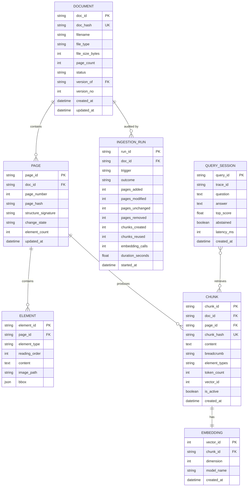
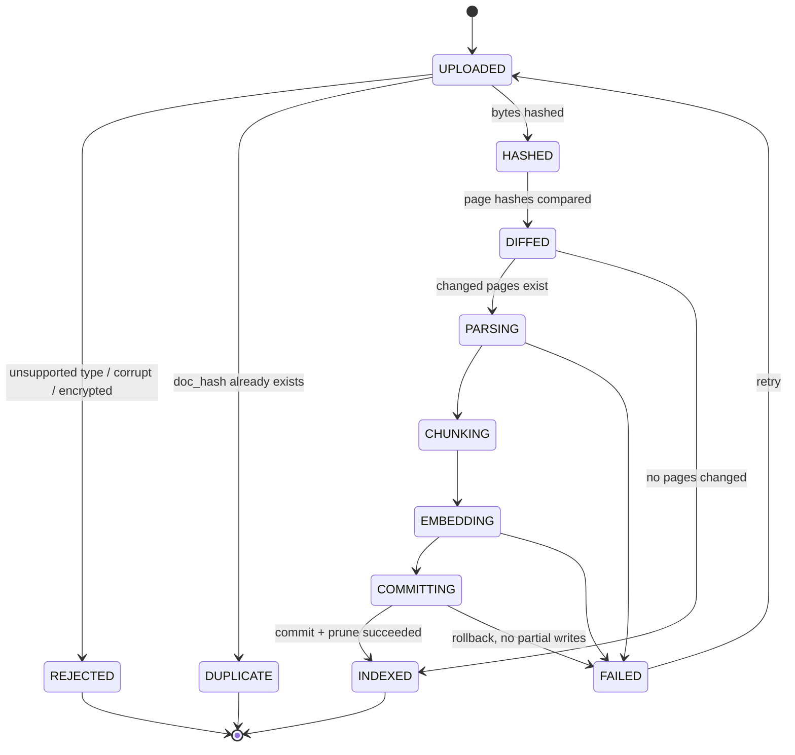

# Data Model — Enterprise Knowledge Assistant (RAG)

**Feature:** 001-enterprise-rag | **Date:** 2026-09-21
**Store:** SQLite (registry) + FAISS (vectors) + BM25 (sparse index)

---

## 1. Entity Relationship

---

## 2. Entity Definitions

### 2.1 DOCUMENT

The identity of an uploaded file. **Identity is content, not filename.**

| Field | Type | Constraints | Notes |
|---|---|---|---|
| `doc_id` | str(36) | PK | UUID4 |
| `doc_hash` | str(64) | UNIQUE, indexed | **Tier 1** — SHA-256 of raw bytes |
| `filename` | str(512) | not null | Original name; not an identity key |
| `file_type` | str(10) | enum | `pdf/docx/pptx/xlsx/txt/md/png/jpg` |
| `file_size_bytes` | int | > 0 | |
| `page_count` | int | ≥ 0 | |
| `status` | str(20) | enum | See §3 state machine |
| `version_of` | str(36) | FK → DOCUMENT, nullable | Set when same filename, new hash |
| `version_no` | int | default 1 | |
| `storage_path` | str(1024) | | Path on disk |
| `created_at` / `updated_at` | datetime | | |

**Validation rules**
- `doc_hash` must be exactly 64 lowercase hex characters.
- A duplicate `doc_hash` must never create a second row — it short-circuits (FR-003).
- `version_of` must not form a cycle.

---

### 2.2 PAGE

One page of a document. The unit of **Tier 2** change detection.

| Field | Type | Constraints | Notes |
|---|---|---|---|
| `page_id` | str(36) | PK | |
| `doc_id` | str(36) | FK, indexed | |
| `page_number` | int | ≥ 1 | Unique with `doc_id` |
| `page_hash` | str(64) | indexed | **Tier 2** — SHA-256 of normalised text **+** `structure_signature` |
| `structure_signature` | str(256) | | e.g. `h:2|p:7|t:1|i:1|order:h,p,p,t,p,i` |
| `raw_text_preview` | str(500) | | First 500 chars, for debugging only |
| `change_state` | str(12) | enum | `unchanged \| modified \| added \| removed` |
| `element_count` | int | | |
| `updated_at` | datetime | | |

**Page hash derivation (must be deterministic)**
1. Extract page text.
2. Strip repeating headers/footers and standalone page numbers.
3. Collapse all whitespace runs to a single space; trim; lowercase.
4. Build `structure_signature` from ordered element types and counts.
5. `page_hash = sha256(normalised_text + "||" + structure_signature)`

---

### 2.3 ELEMENT

A structural unit produced by the layout parser.

| Field | Type | Notes |
|---|---|---|
| `element_id` | str(36) PK | |
| `page_id` | str(36) FK | |
| `element_type` | enum | `heading \| paragraph \| list \| table \| image \| caption \| footnote` |
| `heading_level` | int, nullable | 1–6 when `element_type = heading` |
| `reading_order` | int | Position on page |
| `content` | text | Prose, Markdown table, or generated image description |
| `image_path` | str(1024), nullable | Cropped figure, for UI display |
| `image_hash` | str(64), nullable | Caption cache key (D-003) |
| `bbox` | json, nullable | `[x0, y0, x1, y1]` |

**Rules**
- `element_type = table` → `content` must be valid GFM Markdown with a header row.
- `element_type = image` → `content` must be the model-generated description, and
  `image_path` + `image_hash` must be populated.

---

### 2.4 CHUNK

The retrievable unit. Unit of **Tier 3** change detection.

| Field | Type | Notes |
|---|---|---|
| `chunk_id` | str(36) PK | |
| `doc_id` / `page_id` | str(36) FK, indexed | |
| `chunk_hash` | str(64) UNIQUE, indexed | **Tier 3** — SHA-256 of normalised chunk text |
| `content` | text | Final embedded text, breadcrumb included |
| `breadcrumb` | str(512) | `Doc > Section > Subsection` |
| `element_types` | str(128) | Comma-separated types contained |
| `token_count` | int | ≤ `MAX_CHUNK_TOKENS` |
| `chunk_index` | int | Order within the page |
| `vector_id` | int, nullable | FAISS row id |
| `is_active` | bool | `false` = superseded, pending prune |
| `created_at` | datetime | |

**Rules**
- Only `is_active = true` chunks are searchable.
- On re-ingestion, if an incoming `chunk_hash` already exists and is active, the
  existing `vector_id` is reused and **no embedding call is made** (FR-007).
- Chunks of `removed` pages are set `is_active = false` and their vectors pruned.

---

### 2.5 EMBEDDING

| Field | Type | Notes |
|---|---|---|
| `vector_id` | int PK | FAISS index position |
| `chunk_id` | str(36) FK UNIQUE | |
| `dimension` | int | 3072 |
| `model_name` | str(64) | `text-embedding-3-large` |
| `created_at` | datetime | |

Vectors are stored L2-normalised so inner product equals cosine similarity.
`model_name` is recorded so a future model change can trigger a controlled
full re-index rather than silently mixing vector spaces.

---

### 2.6 INGESTION_RUN (audit)

| Field | Type | Notes |
|---|---|---|
| `run_id` | str(36) PK | |
| `doc_id` | str(36) FK | |
| `trace_id` | str(36) | Correlates with logs |
| `trigger` | enum | `upload \| bulk \| reindex` |
| `outcome` | enum | `new \| duplicate \| updated \| failed \| rejected` |
| `pages_added/modified/unchanged/removed` | int | |
| `chunks_created` / `chunks_reused` | int | |
| `embedding_calls` | int | **Key cost metric** |
| `error_message` | text, nullable | |
| `duration_seconds` | float | |
| `started_at` | datetime | |

This table is the evidence for goal **G4**: a duplicate run must show
`embedding_calls = 0`.

---

### 2.7 QUERY_SESSION (audit)

| Field | Type | Notes |
|---|---|---|
| `query_id` | str(36) PK | |
| `trace_id` | str(36) | |
| `question` / `answer` | text | Retained for evaluation; excluded from logs (Art. V) |
| `retrieved_chunk_ids` | json | Ordered list |
| `top_score` | float | Best fused score |
| `abstained` | bool | True when below confidence floor |
| `latency_ms` | int | |
| `created_at` | datetime | |

---

## 3. State Machines

### Document lifecycle

State transitions are **monotonic** — a document never moves backwards except
through an explicit retry from `FAILED`.

### Page change classification

| Previous version | Current version | State | Action |
|---|---|---|---|
| hash H | hash H | `unchanged` | Reuse vectors. No cost. |
| hash H | hash H′ | `modified` | Re-parse, re-chunk, embed only new chunk hashes |
| absent | present | `added` | Full processing |
| present | absent | `removed` | Deactivate chunks, prune vectors |

---

## 4. Indexes

| Table | Index | Purpose |
|---|---|---|
| DOCUMENT | `UNIQUE(doc_hash)` | O(1) Tier-1 duplicate check |
| DOCUMENT | `(filename)` | Version lineage lookup |
| PAGE | `(doc_id, page_number)` UNIQUE | Page diff join |
| PAGE | `(page_hash)` | Tier-2 comparison |
| CHUNK | `UNIQUE(chunk_hash)` | Tier-3 reuse check |
| CHUNK | `(doc_id, is_active)` | Active-corpus filtering and pruning |
| EMBEDDING | `UNIQUE(chunk_id)` | 1:1 guarantee |
| INGESTION_RUN | `(doc_id, started_at)` | Audit timeline |

## 5. Retention

| Data | Retention |
|---|---|
| Source files | Until explicitly deleted by an administrator |
| Inactive chunks | Pruned at commit; rows purged after 30 days |
| INGESTION_RUN | 1 year |
| QUERY_SESSION | 90 days |
| Application logs | 30 days, no payload content |
