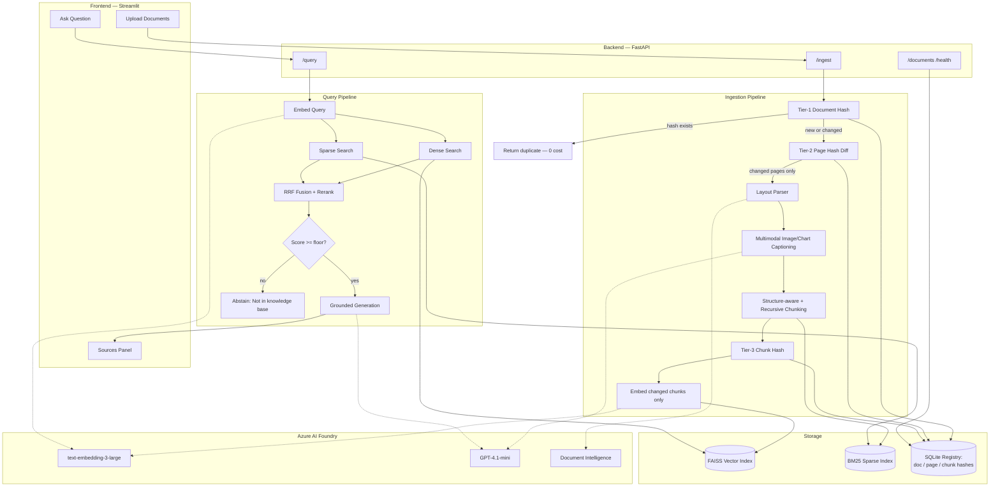
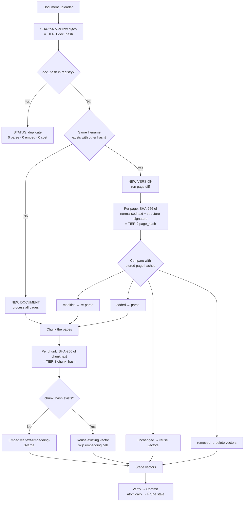
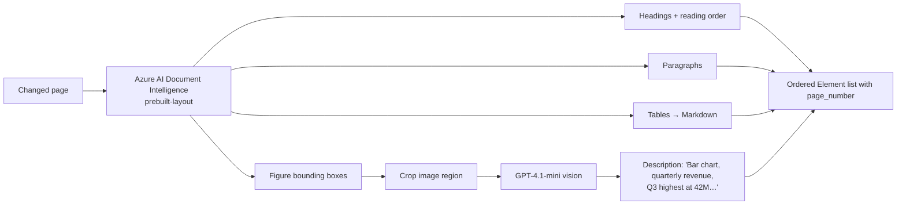

# Implementation Plan — Enterprise Knowledge Assistant (RAG)

**Branch:** `001-enterprise-rag` | **Spec:** `./spec.md` | **Date:** 2026-09-21

> This document turns the *what* in `spec.md` into the *how*. Technology choices
> appear here for the first time. Every choice is justified in `research.md`.

---

## 1. Technical Context

| Dimension | Decision |
|---|---|
| Language | Python 3.11 |
| Backend | FastAPI + Uvicorn |
| Frontend | Streamlit |
| LLM | **GPT-4.1-mini** via Azure AI Foundry |
| Embeddings | **text-embedding-3-large** (3072-dim) via Azure AI Foundry |
| Vision / multimodal | GPT-4.1-mini vision capability (image → description) |
| Layout parsing | Azure AI Document Intelligence (`prebuilt-layout`), with `unstructured` + `pdfplumber` as local fallback |
| OCR | Document Intelligence built-in; Tesseract fallback |
| Vector store | FAISS (`IndexFlatIP`, cosine via normalised vectors) |
| Sparse retrieval | BM25 (`rank_bm25`) |
| Registry / metadata | SQLite via SQLAlchemy (swap to Azure SQL for scale-out) |
| Hashing | SHA-256 (hashlib, stdlib) |
| Config | pydantic-settings + `.env` |
| Testing | pytest + pytest-cov |
| Packaging | Python venv — **no Docker** (Constitution Art. VII) |

## 2. Constitution Check

| Article | Gate | Status |
|---|---|---|
| I — Grounded answers | Confidence floor + citation enforcement in prompt | ✅ Planned |
| II — Idempotent ingestion | Three-tier hash (doc/page/chunk) + transactional commit | ✅ Planned |
| III — Structure is meaning | Document Intelligence layout + multimodal captioning | ✅ Planned |
| IV — Contract-first | `contracts/openapi.yaml` authored before endpoints | ✅ Planned |
| V — Security | Key Vault / env vars, no payload logging, Azure-only inference | ✅ Planned |
| VI — Observability | JSON logs, trace_id, stage timings, `/health` `/ready` | ✅ Planned |
| VII — Simplicity | No Dockerfile; venv only; single-tenant v1 | ✅ Planned |
| VIII — Traceability | tasks.md → FR mapping table | ✅ Planned |

**Result: PASS.** No violations, no complexity deviations to record.

---

## 3. Target Project Structure

```
enterprise-rag/
├── README.md
├── requirements.txt
├── .env.example
├── .gitignore
│
├── .specify/
│   └── memory/
│       └── constitution.md          # Non-negotiable project rules
│
├── specs/001-enterprise-rag/
│   ├── spec.md                      # WHAT + WHY
│   ├── plan.md                      # HOW  (this file)
│   ├── research.md                  # WHY THIS TECH (decision log)
│   ├── data-model.md                # Entities, fields, states
│   ├── quickstart.md                # Run it in 10 minutes
│   ├── tasks.md                     # 60 numbered, traceable tasks
│   └── contracts/
│       └── openapi.yaml             # API contract
│
├── src/
│   ├── backend/
│   │   ├── main.py                  # FastAPI app factory
│   │   └── app/
│   │       ├── core/
│   │       │   ├── config.py        # Settings
│   │       │   ├── logging.py       # JSON logging + trace_id
│   │       │   └── azure_clients.py # Azure AI Foundry clients
│   │       ├── models/
│   │       │   ├── schemas.py       # Pydantic request/response
│   │       │   └── db.py            # SQLAlchemy registry tables
│   │       ├── ingestion/
│   │       │   ├── hashing.py       # T1 doc / T2 page / T3 chunk hashes
│   │       │   ├── parser.py        # Layout + multimodal parsing
│   │       │   ├── chunker.py       # Structure-aware + recursive
│   │       │   ├── embedder.py      # text-embedding-3-large
│   │       │   └── pipeline.py      # Orchestrator (diff → process → commit)
│   │       ├── retrieval/
│   │       │   ├── vector_store.py  # FAISS
│   │       │   ├── bm25_store.py    # Sparse index
│   │       │   ├── retriever.py     # Hybrid + RRF + rerank
│   │       │   └── generator.py     # GPT-4.1-mini, grounded prompt
│   │       └── api/
│   │           ├── routes_ingest.py
│   │           ├── routes_query.py
│   │           └── routes_admin.py
│   └── frontend/
│       └── app.py                   # Streamlit UI
│
├── tests/
├── data/                            # uploads/, index/, registry.db  (git-ignored)
└── scripts/
    ├── run_backend.sh
    ├── run_frontend.sh
    └── bulk_ingest.py
```

---

## 4. System Architecture



---

## 5. The Two-Tier Hashing Design (core differentiator)



**Why the structural signature in Tier 2?** Two pages can have identical text but
different layout (e.g. a paragraph converted into a table). Hashing text alone
would call that "unchanged" and silently keep a wrong chunk. The signature
`(n_headings, n_tables, n_images, ordered element types)` catches this.

**Normalisation before hashing** — collapse whitespace, strip page
headers/footers and page numbers, lowercase. Without this, a re-export of the
same PDF with a different timestamp in the footer would mark every page as
modified and destroy the whole cost saving.

---

## 6. Parsing Strategy



- **Tables** → GitHub-flavoured Markdown, header row preserved. A table is
  atomic unless it exceeds the token budget, in which case it splits by rows
  with the header repeated.
- **Images/charts** → the vision model returns a factual description; the
  description is embedded, the image path is kept in metadata so the UI can
  display the original alongside the citation.
- **Fallback path** (no Document Intelligence / offline): `unstructured` for
  layout + `pdfplumber` for tables + Tesseract for OCR. Selected by
  `PARSER_BACKEND` in config so the pipeline code is unchanged.

## 7. Chunking Strategy

| Parameter | Value |
|---|---|
| Target chunk size | 800 tokens |
| Max chunk size | 1,000 tokens |
| Overlap | 120 tokens |
| Separator ladder | `\n## ` → `\n### ` → `\n\n` → `\n` → `. ` → ` ` |
| Breadcrumb prefix | `Document > Section > Subsection` prepended to every chunk |

Pass 1 groups elements into sections using heading levels. Pass 2 applies
recursive character splitting **only** to sections over budget. Tables and image
descriptions bypass pass 2 where possible.

## 8. Retrieval Strategy

1. Embed query with `text-embedding-3-large`.
2. Dense: FAISS inner-product search over L2-normalised vectors → top 20.
3. Sparse: BM25 → top 20.
4. Fuse with **Reciprocal Rank Fusion**: `score = Σ 1/(60 + rank)`.
5. Re-rank the fused top 20 with a cross-encoder-style LLM scoring pass → top 5.
6. Gate: if best fused score `< RETRIEVAL_MIN_SCORE` → abstain (FR-025).
7. Generate with GPT-4.1-mini, temperature 0.2, citation-enforcing system prompt.

## 9. Phased Delivery

| Phase | Content | Exit criteria |
|---|---|---|
| **0 — Foundation** | Repo scaffold, config, logging, Azure client wiring, health endpoints | `/health` returns 200; Azure connectivity smoke test passes |
| **1 — Hashing & Registry** | SQLite schema, Tier-1/2/3 hashing, diff engine | Re-upload of identical file → `duplicate`, 0 embed calls (unit-tested) |
| **2 — Parsing** | Layout parser, table→Markdown, multimodal captioning, OCR | Table and chart questions answerable manually from element output |
| **3 — Chunking & Embedding** | Structure-aware + recursive chunker, embedder with batching/backoff | Chunk-hash reuse demonstrated on a one-line edit |
| **4 — Retrieval & Generation** | FAISS, BM25, RRF, rerank, grounded generator, abstention | Golden-question set passes; abstention verified |
| **5 — API & UI** | All endpoints per contract, Streamlit upload/chat/sources | End-to-end demo from browser |
| **6 — Hardening** | Tests to 80%, structured logs, runbook, README, eval set | All gates green; manager walkthrough |

## 10. Risks

| Risk | Impact | Mitigation |
|---|---|---|
| Azure quota/throttling on embeddings | Slow ingestion | Batch 64 inputs/call, exponential backoff, resumable runs |
| FAISS in-memory limit as corpus grows | Scale ceiling | Interface-abstracted store; swap to Azure AI Search in v2 |
| Vision captioning cost on image-heavy decks | Budget | Cache caption by image hash; skip decorative images below size threshold |
| Header/footer noise defeating page hashing | Lost cost savings | Normalisation step strips repeating headers/footers before hashing |
| Corporate network blocking outbound calls | Dev blocked | Local fallback parser backend + `.env` proxy/CA-bundle settings |
